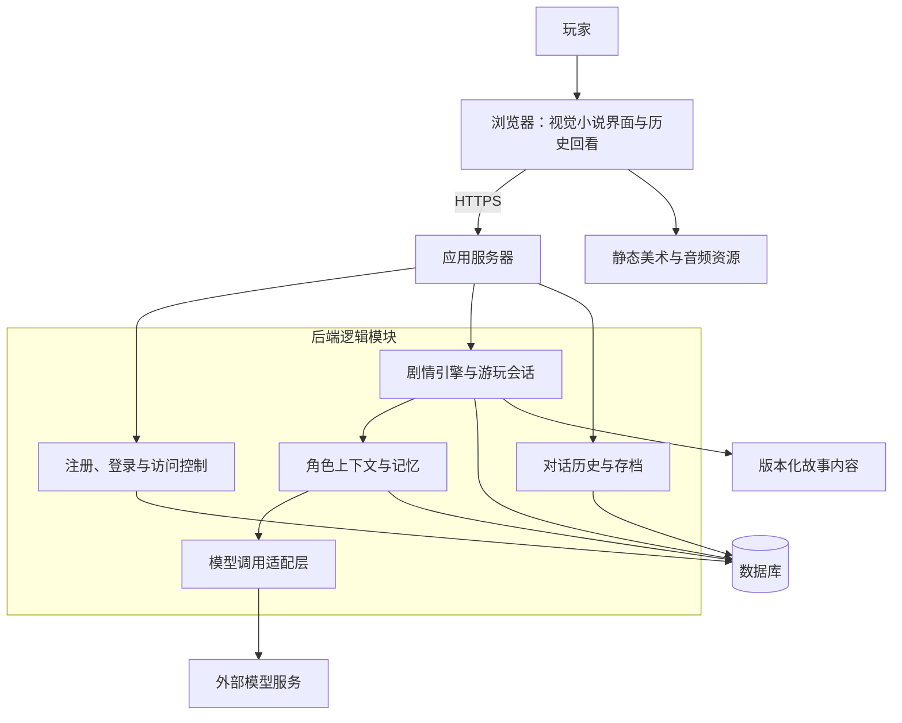

# From Your Dream 技术架构

> 状态：架构讨论稿，作为 MVP 的设计基线；尚未实现。
>
> 整理日期：2026-10-17。
>
> 本文记录已确认的产品约束，并给出相应的模块划分和数据流建议。具体技术栈、登录方式和模型提供方仍待确定。

## 1. 已确认的方向

| 项目 | 决定 |
| --- | --- |
| 产品形态 | B/S 架构，通过浏览器访问 |
| 游玩方式 | 单人游玩，每位玩家拥有独立的进度与对话记录 |
| 账号 | 支持注册与登录 |
| 故事创作 | 初期由作者编写角色、场景、剧情规则和素材配置 |
| AI 互动 | 推进 AI 对话需要联网调用模型 |
| 历史查看 | 支持查看已保存的玩家输入、角色台词和旁白 |
| 数据保存 | 服务端保存玩家进度、历史对话和角色记忆，并关联到账号 |

单人游玩描述的是游戏体验。应用运行于服务器，玩家通过账号访问自己的数据，可以在不同设备上继续游玩。

## 2. 总体结构

建议 MVP 使用一个前端应用、一个按模块组织的后端应用，以及一个数据库。后端内部划分业务职责，初期共同部署。

核心原则：**剧情引擎决定状态和故事走向，模型在允许的范围内生成角色表达。**

## 3. 模块职责

### 3.1 浏览器前端

- 呈现场景背景、角色立绘、表情、旁白、台词和选项。
- 提供注册、登录、故事选择、继续游玩和历史对话入口。
- 接收玩家的自由输入或选项，发送互动请求。
- 展示生成等待、失败重试及会话恢复状态。
- 根据服务器返回的结果播放演出，并展示最新进度。

浏览器可以缓存素材和界面状态；剧情进度、角色状态与存档以服务端数据为准。浏览器仅接收当前呈现需要的内容，未触发的剧情条件和角色秘密保留在服务端。

### 3.2 账号与访问控制

- 完成注册、登录、退出和登录会话管理。
- 将游玩会话、存档和历史记录关联到玩家账号。
- 每次读写玩家数据时校验归属，避免通过记录 ID 访问其他玩家的数据。

具体采用邮箱密码、用户名密码还是第三方登录，后续确定。若采用密码登录，服务端保存密码哈希，登录凭证使用安全的会话机制管理。

### 3.3 剧情引擎

- 读取作者编写的故事、场景、选项、触发条件和结局规则。
- 管理章节进度、当前场景、路线和剧情标记。
- 判断当前可交互的角色、可用选项和允许的行动范围。
- 校验模型输出，并根据规则提交角色与剧情状态变化。
- 生成前端需要的演出结果，例如背景切换、表情和台词顺序。

模型可以给出候选行动或状态变化建议；实际生效的内容必须经过剧情规则校验。关键节点和结局条件由作者定义。

### 3.4 角色上下文与记忆

每个角色拥有独立的设定、状态和记忆范围。这里的独立 Agent 指独立的角色配置与上下文，初期可以在同一个后端进程中执行。

每次生成时，按需组装以下信息：

- 角色身份、性格、表达方式、目标和立场。
- 角色当前可知的场景信息与剧情事实。
- 当前情绪、关系状态和相关长期记忆。
- 近期对话与玩家本轮输入。
- 本轮允许的行动、输出格式及可使用的素材标识。

角色记忆服务于连续性，只保存对后续互动有意义的事实或摘要。不同角色的知识范围分别控制，未经历或未被告知的事件不能直接成为角色已知信息。

### 3.5 模型调用适配层

- 统一模型请求、结构化响应解析、超时和错误处理。
- 在服务端管理模型密钥与模型配置。
- 记录调用状态、耗时和用量，便于排查失败与观察成本。
- 将模型提供方的接口细节封装在模块内部。

新一轮 AI 对话必须调用模型。模型不可用时提示玩家重试，当前已提交的剧情进度保持可恢复。登录、读取存档和查看历史对话直接读取服务端数据。

### 3.6 对话历史与存档

- 保存玩家输入、角色台词、旁白及必要的演出信息。
- 按游玩会话和轮次组织记录，支持按时间顺序分页回看。
- 保存最近一次有效的剧情与角色状态，供继续游玩使用。
- 将生成失败或处理中请求与已完成的故事记录区分开。

历史查看直接返回当时保存的内容，不重新调用模型生成。角色记忆摘要可以精简或更新，已经保存的对话原文保持独立。

## 4. 一轮互动的数据流

1. 玩家登录后，打开一个故事或继续已有游玩会话。
2. 浏览器提交玩家输入或选项，同时携带请求标识和当前进度版本。
3. 后端校验账号、会话归属、进度版本及当前允许的交互。
4. 剧情引擎确定本轮参与角色、允许的行动与相关剧情条件。
5. 后端组装角色上下文，调用模型生成结构化回应。
6. 校验回应的字段、角色身份、素材标识和候选状态变化；不符合要求时执行受限重试或返回失败。
7. 剧情引擎计算最终状态，在同一数据库事务中保存已完成的对话、演出信息和新状态。
8. 浏览器收到成功结果并播放演出；玩家之后可以从历史记录中查看这一轮内容。

模型请求在数据库事务之外执行，避免长时间占用事务。重复提交或网络重试应通过请求标识复用同一轮结果；同一个游玩会话的推进请求应串行处理或进行版本冲突校验，防止多标签页覆盖进度。

初期可以在整轮结果校验并保存后返回前端。是否增加流式输出，后续根据体验确定；若增加，展示中的临时文本与最终保存结果需要有明确区别。

## 5. 数据划分

下表是概念层面的数据划分，后续再细化表结构与字段。

| 数据 | 主要内容 | 归属与作用 |
| --- | --- | --- |
| 用户与登录会话 | 账号标识、认证信息、会话有效期 | 识别玩家和控制访问 |
| 故事版本 | 故事标识、版本、内容与资源引用 | 固定一次游玩所使用的内容 |
| 游玩会话 | 玩家、故事版本、创建时间、游玩状态 | 区分不同周目 |
| 剧情状态 | 章节、场景、路线、剧情标记、进度版本 | 继续游玩的当前状态 |
| 角色状态 | 角色、情绪、关系与当前目标等 | 归属于具体游玩会话 |
| 对话轮次与事件 | 请求标识、顺序、玩家输入、角色回应、旁白、演出及处理状态 | 历史回看和请求去重 |
| 角色记忆 | 角色可知事实、互动摘要、来源轮次 | 为后续生成提供有限上下文 |
| 存档快照 | 对应轮次、剧情状态、角色状态和记忆版本 | 恢复到一致的游玩位置 |

不同玩家、不同周目的角色状态和记忆相互隔离。MVP 可以先提供每个周目的自动存档与继续游玩；手动存档槽、回退重玩和分支存档的具体交互待定。

对话历史、角色记忆和存档承担不同职责：历史保留实际发生的内容，记忆用于模型理解上下文，存档用于恢复游玩状态。初期以当前状态加对话事件记录实现，无需引入完整的事件重放体系。

## 6. 作者内容与版本管理

初期建议将故事内容作为结构化文件与素材文件维护，并纳入版本管理。具体采用 JSON、YAML 或其他格式，后续确定。

故事内容包含：

- 世界观、角色设定和角色初始状态。
- 场景、开场信息、选项及允许的自由互动范围。
- 剧情条件、状态变化、场景跳转和结局规则。
- 背景、立绘、表情和音频的资源引用。

每次发布形成明确的故事版本，游玩会话绑定该版本。作者更新内容后，已有进度继续使用原版本；未来如需迁移存档，应提供明确的兼容与迁移规则。

故事源文件、玩家运行数据与生成结果分别保存。模型生成内容记录在玩家的游玩会话中，不覆盖作者的故事源文件。

## 7. MVP 部署建议

初期部署由 Web 前端、一个后端应用、一个数据库及静态资源组成。前端与 API 优先同域提供，通过 HTTPS 访问；图片和音频可由静态资源服务提供。

数据库保存账号和玩家数据，故事文件随版本发布。初期可以使用同步请求完成一轮生成，并限制同一游玩会话的并发推进；等实际用量和耗时明确后，再评估任务队列、缓存或独立服务的需要。

## 8. 待确定的技术选择

- 前端框架、视觉小说界面实现方式。
- 后端语言与框架、数据库及数据访问工具。
- 注册登录方式、登录会话与账号恢复方案。
- 模型提供方、模型、结构化输出能力及调用预算。
- 故事文件格式、内容校验方式和首个故事的数据结构。
- 是否支持流式输出，以及多个角色的发言组织方式。
- 部署环境、素材存储和数据备份方案。

上述选择在开始实现前逐项收敛；当前确定的 B/S 结构、服务端状态管理和模块职责可作为选型依据。
