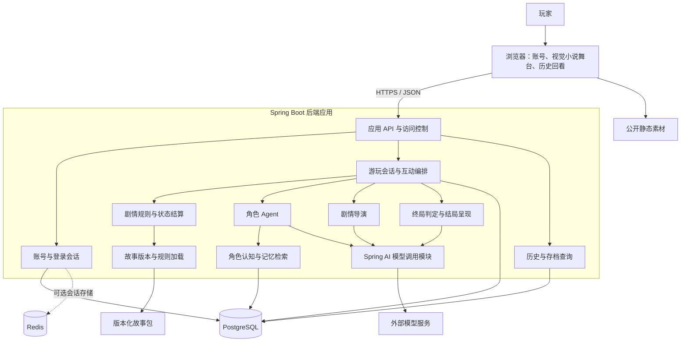
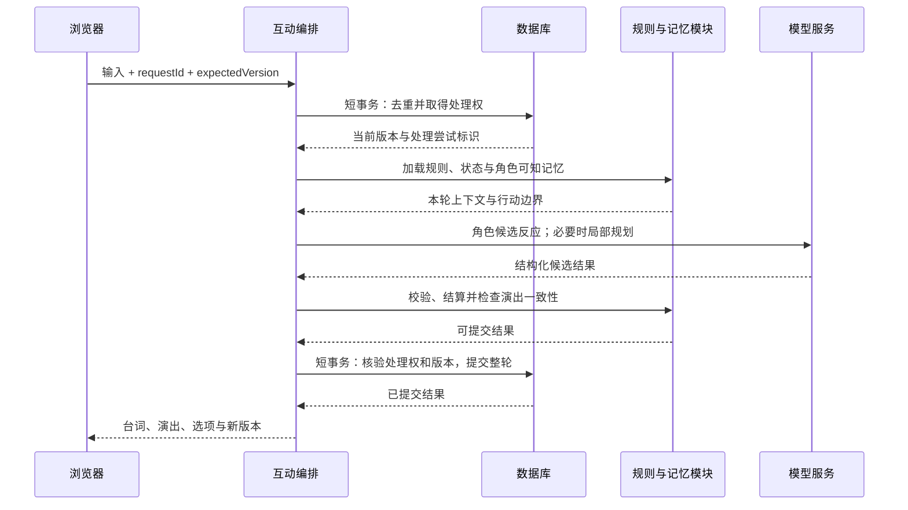
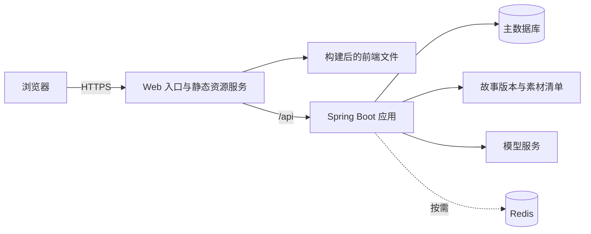

# From Your Dream 技术架构

> 文档状态：MVP 架构设计基线，包含已确认的产品约束和建议的实现方案。
>
> 更新日期：2026-10-21。
>
> 产品方向与 Spring AI 选型已确认，当前原型接入 DeepSeek。现阶段优先使用已有字符串账号与进程内存，不接关系数据库；后文中的注册登录和持久化方案属于后续目标。

## 1. 产品目标与范围

From Your Dream 是一款 AI 驱动的视觉小说 Web 应用。玩家通过对话、选项和行动影响角色及故事，经历具有因果关系的剧情，并到达由本局事件形成的结局。

### 1.1 已确认的产品约束

| 项目 | 方向 |
| --- | --- |
| 应用架构 | B/S，玩家通过浏览器访问服务器 |
| 游玩方式 | 单人游玩；不同玩家、不同周目的状态分别保存 |
| 账号 | 支持注册、登录和退出 |
| 内容创作 | 初期由作者编写世界观、角色、故事规则和素材配置 |
| 模型使用 | 新的 AI 剧情互动需要联网调用模型 |
| 数据保存 | 进度、历史对话和角色记忆保存在服务端并关联账号 |
| 历史查看 | 查看已保存的台词、旁白与玩家输入，不重新生成 |

### 1.2 本文采用的剧情设计方向

- 作者提供故事边界、初始冲突、角色动机、节奏要求和终局规则。
- 角色通过自身设定、经历、当前认知和目标决定行为。
- 玩家行动能够改变事件、关系、角色决定及最终结果。
- 剧情导演根据已发生的事件动态规划后续场景。
- 系统根据最终状态生成结局场景与尾声，无需预先枚举完整结局文本。

具体结局可以动态形成；结束条件、行动边界和状态变更规则必须足够明确，才能实现可验证的收束。

## 2. 仓库现状与技术选型

### 2.1 当前已有内容

根据本次读取的仓库文件，当前包含：

- `README.md`：产品构想与体验目标。
- `backend/`：Java / Spring Boot 后端骨架。
- `backend/pom.xml`：声明 Java 17、Spring Boot 4.1.1，以及 Web MVC、Redis、OpenAPI 和 Log4j2 等依赖。
- Redis 账号字符串生成与查询接口，以及统一响应对象 `Result<T>`。
- Spring AI 2.0.1 与 DeepSeek 模型接入，使用服务端环境变量配置密钥。
- 基于字符串账号隔离的内存游戏状态、角色记忆摘要、完整历史、请求去重与重新开始。
- 根据用户提供的《剧幕之外》简介补全初始发展脉络、五个剧情里程碑和可能结局，玩家扮演夏玥，通过弹幕与白瑾互通信息；里程碑可以包含多次选择，后续幕数与结局方向按实际结果修订。导演独知的真相与公共背景分开配置。人物卡包含夏玥、白瑾、王珊、外卖凶手和周年；夏玥由玩家控制，周年按实际建立的影片线联系参与调查。
- 由故事配置提供开场事件、角色主动台词和关键决策。每个玩家回合都有 2 至 4 个包含行动与取舍的选项，后续选项依据实际历史生成；玩家也可自由提出其他决定。
- `SceneEngine` 维护实际环境、互动名单、当前里程碑与每局独立的大纲。里程碑结束后由导演修订尚未发生的发展与结局方向，并记录原幕结果、影响、回合范围和修订版本；已完成节点不能重新进入。
- 每段事件记录见证者与零至多个角色回应；角色只接收自己在场时的近期历史，离场期间的内容不会自动补入其认知。
- 由后端直接提供的 HTML / CSS / JavaScript 演示页面，以及核心流程自动化检查。

当前页面通过 `userId` 请求参数提交已有接口生成的字符串，服务端兼容 `X-User-Id` 请求头，避免预览或转发环境丢失自定义请求头。支持 `user_` 前缀并检查 Redis 中的 ID 是否存在。字符串暂时代替正式账号认证。游戏状态、角色记忆和历史由单个后端进程管理，重启清空。

当前每轮先由场景引擎根据各角色可知的情境安排零至多名回应者，再分别生成反应，后生成者能读到本轮先前的公开回应，最后连续演绎日常对白和行动，结算环境、在场名单与本幕结束状态，并生成下一组重大选项或结局。叙事者可代写玩家在已选方向内的普通应答，重大立场、感情和承诺仍由玩家决定。幕的结束依据核心问题是否已有实际结果，不按选择次数或地点变化判断。幕末大纲允许调整剩余节点的顺序、数量与路径，实际环境和人员不会被预案重置；实际终局可在任何幕落定。角色回应、叙事结果、大纲修订、下一组关键选项、所有见证者的记忆与结局在同一快照中提交。历史记录决策问题、所选行动与风险，后续生成持续参考完整决策历史。当前已实现里程碑推进与幕末大纲修订；世界规则和实际因果的语义约束仍主要依赖模型指令，完整行动规则、事实级校验、长期记忆检索与关系数据库仍属于后续目标。运行方式见 `README.md`。

### 2.2 技术选型与建议

| 层次 | 方案 | 当前状态与理由 |
| --- | --- | --- |
| Web 前端 | 当前使用原生 HTML / CSS / JavaScript 演示页 | 完整前端框架待定，Vue 3 + TypeScript + Vite 为候选方案 |
| 前端演出 | HTML / CSS、图片与浏览器音频能力 | 先覆盖背景、立绘、表情、文字和基本转场 |
| 后端 | 延续现有 Java / Spring Boot / Web MVC | 复用已有工程，内部按业务模块划分 |
| 身份认证 | 当前使用已有账号字符串，后续可接 Spring Security | 正式注册登录暂缓，原型通过请求头选择身份 |
| 主数据库 | 当前不接入，游戏数据保存在进程内存 | PostgreSQL 为后续持久化的候选方案 |
| 数据访问 | 关系字段 + 明确 SQL；工具待定 | 核心标识和约束使用关系字段，可变剧情数据按需使用 JSONB |
| Redis | 当前用于生成、列出和识别账号 ID | 后续可用于缓存或会话；正式长期数据另行持久化 |
| 故事内容 | 版本化 JSON 文件 + 素材清单 | 待实现；由作者编辑，发布后形成不可变版本 |
| 模型接入 | Spring AI，以 `ChatClient` 调用 DeepSeek | 当前默认 `deepseek-chat`，地址和模型名可通过环境变量调整 |
| API | HTTPS + JSON | 第一版按整轮请求返回；流式输出后续按体验需要增加 |

Vue 的官方工具链提供 Vite 和 TypeScript 支持；这里将其作为候选前端方案。[Vue 工具链文档](https://vuejs.org/guide/scaling-up/tooling.html)

PostgreSQL 提供 JSONB 类型，可用于保存部分结构可变的剧情状态；账号归属、版本、顺序和唯一约束仍使用关系字段管理。[PostgreSQL JSON 类型文档](https://www.postgresql.org/docs/current/datatype-json.html)

Spring AI 负责模型接入与响应转换。角色、记忆检索、剧情导演和规则结算由普通 Spring Service 组织。依赖接入时使用 Spring AI BOM 统一版本，并根据最终提供方选择模型模块。[Spring AI 接入文档](https://docs.spring.io/spring-ai/reference/getting-started.html)

## 3. 总体架构

采用浏览器前端、一个按业务模块组织的后端应用、主数据库和故事资源的结构。角色 Agent、剧情导演和记忆模块先在同一后端应用中运行。



浏览器接收当前可以展示的内容；未来剧情、角色秘密、模型密钥和内部导演计划保留在服务器。

## 4. 核心职责与决定权限

| 部分 | 负责的决定 | 约束 |
| --- | --- | --- |
| 作者 | 世界规则、角色初始设定、资源、行动范围、核心冲突、终局条件 | 内容发布后按版本保存 |
| 玩家 | 主角的表达、选项和尝试采取的行动 | 行动能否实现由当前状态与规则判断 |
| 角色 Agent | 符合角色认知与动机的候选行动、态度和台词 | 不能直接修改全局状态或读取未知秘密 |
| 剧情导演 | 后续场景建议、冲突焦点和节奏安排 | 不能改写已经发生的事实或强制达成特定结局 |
| 规则引擎 | 行动可行性、状态变更、事件成立与终局判定 | 只提交符合故事规则的结果 |
| 结局呈现模块 | 根据最终状态组织收尾场景与尾声 | 不能凭空添加决定结局的新事实 |

玩家输入“我已经拿到钥匙”首先表示玩家的表达或行动意图；钥匙是否实际获得，要结合物品状态、已发生事件和可执行行动判断。

剧情权威状态由规则引擎管理。模型承担意图理解、角色行为建议、局部规划和语言表达；结构合法的输出仍需经过业务校验。

## 5. 前端设计

### 5.1 页面与组件

- 账号页面：注册、登录、退出及登录过期处理。
- 故事入口：故事简介、开始新周目、继续已有周目。
- 视觉小说舞台：背景、立绘、表情、角色名、台词、旁白、选项和自由输入。
- 历史界面：按周目和轮次分页查看已经展示过的内容。
- 进度界面：最近存档、章节信息和已经完成的结局。

舞台内部可按背景、角色层、对话框、选项区和输入区拆分组件。首版通过 DOM 和 CSS 完成基本演出，具体动画复杂度由素材与体验决定。

### 5.2 前端状态

前端保存登录展示状态、当前舞台、正在播放的事件和本轮请求状态。服务器保存剧情进度、角色状态和已经提交的历史。

同一周目生成期间，前端显示等待状态并限制重复推进。刷新或网络重连后，通过请求状态与服务器进度恢复界面。

前端可以缓存素材和已读取的历史片段；跨设备进度和完整历史以服务器数据为准。模型服务不可用时，只要应用服务可访问，仍可查看已保存的记录。

## 6. 作者内容与故事包

### 6.1 内容结构

建议每个故事包包含以下内容：

| 内容 | 作用 |
| --- | --- |
| 清单 | 故事标识、内容格式版本、发布版本、入口与素材清单 |
| 世界设定 | 已确定的世界事实、时间规则、地点和能力边界 |
| 角色卡 | 身份、价值观、语言习惯、目标、秘密、底线与初始认知 |
| 初始局面 | 核心冲突、参与角色、初始资源和已发生事件 |
| 场景素材 | 可用地点、背景、立绘、表情和音频 |
| 行动与条件 | 可执行行为、前置条件、可能效果与允许的状态范围 |
| 叙事要求 | 主题、阶段目标、必要信息和可选冲突素材 |
| 终局规则 | 结束条件、截止机制、最终需要回答的问题 |

第一版使用程序支持的条件和行动类型，按故事配置参数与效果。模型生成内容必须映射到这些类型；扩展新的能力需要同步增加相应规则。

### 6.2 大纲的作用

大纲可以定义“建立关系、冲突显现、关键选择、承担后果、收束”等叙事功能。具体阶段名称由作者决定，部分阶段可合并或跳过。

不必在开始前规划所有场景或枚举完整结局。若作者确有必须发生的事件，应在故事设定中明确其成立原因与可变部分，避免玩家完成相反行动后仍被迫进入相同结果。

### 6.3 内容发布

发布前检查角色与场景引用、状态字段、素材标识、条件表达和终局规则。每次发布形成不可变故事版本，周目绑定具体版本。

已有周目继续加载绑定版本及其素材。后续如需升级已有存档，另行提供兼容与迁移策略。故事包保留在服务器，浏览器只获取公开简介和当前呈现需要的数据。

## 7. 运行时状态模型

系统区分以下信息：

| 状态 | 示例 | 更新依据 |
| --- | --- | --- |
| 世界事实 | 钥匙在谁手中、演出是否取消 | 已校验并提交的事件 |
| 角色认知 | 某角色知道钥匙被取走 | 亲历、观察、被告知或允许的推断 |
| 角色信念 | 某角色怀疑玩家藏起钥匙 | 有来源的主观判断，可被修正 |
| 角色状态 | 情绪、信任、当前目标 | 经历及规则允许的变化 |
| 剧情状态 | 场景、阶段、时间、有效行动窗口 | 场景推进和事件结算 |
| 未完成事项 | 承诺、矛盾、尚待回应的决定 | 创建、推进、完成或失效事件 |
| 导演计划 | 下一场景的候选焦点 | 根据当前状态生成，失效后重规划 |

台词中的陈述本身可以成为事件，例如“A 告诉 B 自己拿到了钥匙”；这不自动证明钥匙已归 A 所有。事件记录保留说话者、接收者和真实状态之间的区别。

导演计划描述未来意图，独立于已发生事实。只有执行并提交的事件才能进入事实记录。

## 8. 角色 Agent 与长期记忆

### 8.1 角色的独立性

每个角色拥有独立的设定、认知、当前目标和经历范围。不同角色可以共用模型提供方和模型参数，独立性由上下文与状态隔离实现。

维持角色一致性依赖价值观、动机和行为边界。人物成长通过事件推动，并记录变化依据；即时情绪与长期性格分别管理。

### 8.2 记忆分层

| 层次 | 保存内容 | 使用方式 |
| --- | --- | --- |
| 核心设定 | 身份、价值观、表达习惯、重要底线 | 每轮加入精简版本 |
| 当前状态 | 目标、情绪、关系、当前可知事实 | 按场景加载 |
| 经历记录 | 事件、时间、参与者、结果和知情依据 | 按角色与话题检索 |
| 重要事项 | 约定、承诺、正在发生的冲突和决定 | 在有效期间强制纳入相关场景上下文 |
| 反思与摘要 | 对经历的理解、关系判断、阶段摘要 | 保留来源，允许更新 |
| 完整历史 | 玩家输入、台词、旁白和行动 | 精确回看、追溯和补充查询 |

外部记录、按需检索和反思可参考《Generative Agents》的记忆架构。该研究也报告了检索失败和虚构细节，因此这里将来源记录、知识隔离和关键事实校验作为额外约束；不能保证模型每次表达都完全准确。[研究论文](https://arxiv.org/html/2304.03442v2)

### 8.3 记忆写入

1. 将已经校验的台词、行动和结果提交为事件，保留原始内容。
2. 根据在场关系和信息传播，确定每个角色实际获知的内容。
3. 同步更新重要承诺、关键事实、目标和状态。
4. 在场景结束或上下文需要压缩时，生成带来源事件编号的摘要与反思。
5. 对反思保留主观标记；对状态更新保留依据，避免推测直接成为世界事实。

例如，“玩家约定明天送站”需要记录时间、地点、双方、来源和履行状态；失约后形成新的事件，再影响角色关系与后续行为。

摘要可以延后生成，原始事件与关键状态必须先提交。检索时检查摘要覆盖到哪一轮，补充尚未纳入摘要的相关事件。延后任务根据数据库中的覆盖进度重试，首版可在应用内执行。

### 8.4 记忆检索

1. 先限定玩家周目、角色、故事时间和知情范围。
2. 加入当前目标、有效承诺、关键事实和当前冲突。
3. 根据本轮提及的人物、地点、物品和事件，查找相关经历。
4. 补充近期对话与相关场景摘要。
5. 在上下文预算内排序、去重并保留来源引用。

重要承诺和当前冲突通过结构化关联检索。其他经历先使用标签、实体关联与全文检索；实际出现同义表达查找不足时，再增加向量检索。访问范围过滤始终先于内容检索。

### 8.5 上下文预算与遗忘处理

优先保留角色核心、当前场景约束、必要事实和有效事项，再分配给近期对话与可选经历，并为模型输出留出空间。

信息超出预算时，先减少低相关记录或拆分场景。关键状态保存在结构化数据中，摘要始终能追溯到原始事件。无法确认的经历允许角色表达不确定，而不是补写成确定事实。

角色记忆可以精简，历史回看始终读取原始已展示记录。两个用途使用各自的数据视图。

## 9. 剧情导演与动态推进

### 9.1 导演输入与输出

导演读取作者的叙事要求、当前世界状态、角色目标、玩家行动、未完成事项与剩余故事时间，提出：

- 当前最值得推进的冲突或问题。
- 下一场景的目的、参与者与允许地点。
- 可自然出现的事件、机会和信息。
- 阶段推进或进入收束的建议。

计划保留生成时的进度版本。玩家的重要行动改变前提后，旧计划需要失效或调整。角色只接收本轮可知的情境和行动边界。

采用剧情管理器组织叙事片段、协调玩家行动与节奏，可以参考《Façade》的互动戏剧研究。本文建议在此基础上按当前局面动态规划，并通过规则约束结果。[研究论文](https://eis.ucsc.edu/papers/MateasSternDIGRA05.pdf)

### 9.2 短程规划

第一版只规划接下来一两个场景。在场景结束、重要冲突解决、核心目标改变或截止条件触发时重新调用导演；普通台词轮次复用有效计划。

玩家已经化解的冲突应得到承认。后续内容根据剩余目标和后果展开，不为恢复原计划而无依据地重建同一冲突。

### 9.3 推进与停滞处理

- 角色根据自身目标主动提出请求、作出决定或离开场景。
- 关键行动消耗作者定义的故事时间或资源。
- 长时间停滞时，先通过情境提示压力、机会和可能后果。
- 场景达到已定义的交互上限后，按明确机制推进时间或结束场景。
- 玩家拒绝参与、拖延或未完成目标，也能形成可结算的后果。

如果要求每局在有限的主线交互内结束，故事必须提供有限的时间或场景预算、单调推进的规则及覆盖“拒绝行动”的终局路径。自由输入的文字长度不决定故事时间；时间由实际被结算的行动和场景规则推进。

进入收束阶段后，优先处理核心矛盾与当前有效事项。新产生的内容应服务于收尾，避免不断开启新的主要任务。

## 10. 动态结局设计

### 10.1 作者定义的终局规则

作者需要明确：

- 本篇必须回答哪些核心问题。
- 哪些目标可以完成、失败、放弃或变得不可实现。
- 哪些截止事件会使局面进入不可逆阶段。
- 如何处理玩家持续回避关键决定的情况。
- 结尾允许保留哪些次要悬念。

终局规则表达可检查的条件。模型可以建议进入收束，但不能独自决定是否已满足结束条件。

### 10.2 从状态形成结局

```text
已提交事件、当前状态与本轮通过校验的候选结果
    → 规则引擎判定终局
    → 汇总目标结果、角色决定、关系与代价
    → 模型生成结局场景与尾声
    → 校验事实、知情范围和因果依据
    → 将本轮事件、最终状态与结局文本原子提交
```

结果结构至少包含核心目标的状态、主要角色最后的决定、关系结果、不可逆变化，以及支持这些结果的事件引用。

若本轮行动触发终局，结局与本轮结果一起校验和提交；失败时保留上一轮有效状态。提交后周目标记为已结束，后续请求可以回看或开始新周目，不再推进该周目的剧情。结局重复查询返回保存的文本。

结局呈现可以回顾承诺、引用旧场景或呼应主题，但不能临时添加未发生的和解、牺牲或关键证据。对于尚未被状态或规则支持的未来，只能采用明确的开放表达。

### 10.3 多结局的实际含义

同一初始局面下，玩家行动应能改变目标是否实现、谁参与、人物去向、关系及付出的代价。结局文案上的差异不单独视为结果差异。

故事可产生作者未逐项写出的结果组合，但仍受已建模的行动、资源和因果规则约束。第一版优先支持少量明确的状态维度，再按实际故事需要扩展。

## 11. 一轮互动的编排

### 11.1 处理步骤

1. 校验登录身份、周目归属、周目状态与输入长度。
2. 根据请求标识检查已完成结果或处理中请求，取得本轮处理权。
3. 读取当前进度版本、故事规则、有效导演计划和相关角色记忆。
4. 将玩家输入解释为表达或候选行动，校验其前置条件。
5. 根据在场角色的认知和动机生成候选反应与行动。
6. 规则引擎结算可成立的行动、状态变化和信息传播。
7. 根据结算结果生成或修正台词与演出，检查其与事实是否一致。
8. 在场景边界评估导演计划；满足终局时生成并校验结局内容。
9. 以短事务原子提交本轮事件、新状态、关键记忆、必要存档和完成结果。
10. 返回已提交的前端演出结果，按覆盖进度补充可延后的摘要。

角色反应与演出台词可以在无歧义时合并生成；涉及冲突行动时，先结算结果，再让角色表达结果。多个角色对同一世界状态的修改依次结算。



### 11.2 并发、重试和故障恢复

- 以 `(game_session_id, request_id)` 唯一约束实现请求去重；相同标识但不同输入应拒绝。
- 已完成的重复请求直接返回原结果，避免重复推进。
- 同一周目同一时刻只允许一轮推进；不同周目可以并发。
- 使用数据库中的处理状态、有效期和处理尝试标识管理处理权，最终提交同时核验 `expectedVersion`。
- 处理中断或有效期届满后，由新尝试接管；旧尝试即使返回也不能提交。
- 模型调用在数据库事务之外执行，避免长时间持有事务或行锁。
- 数据库提交失败时不向玩家确认成功；提交成功但响应丢失时，通过查询或重试取得同一结果。

建议轮次状态为 `PENDING`、`COMPLETED`、`FAILED`。失败请求不推进已提交状态。首版优先同步完成整轮，前端断线后查询轮次状态；恢复处理依靠持久化记录。

该机制保证每轮状态最多提交一次。模型提供方超时或连接中断时，无法仅靠本地去重保证外部模型绝不被重复调用；需限制重试次数，并记录调用尝试和成本。

## 12. 模型调用与输出校验

### 12.1 调用职责

已选定 Spring AI 作为模型接入框架，使用 `ChatClient` 支持角色生成、局部导演规划、摘要和结局呈现。各任务使用不同上下文与输出格式，先复用同一个提供方。

使用 Spring AI 的模型适配与响应转换能力完成请求发送和结构化结果读取，业务层统一管理超时、错误映射、重试预算和用量记录。模型密钥只在服务端配置。具体模型模块、模型名称和参数在确定提供方后选择。[ChatClient 文档](https://docs.spring.io/spring-ai/reference/api/chatclient.html)

每轮由业务层显式组装角色设定、当前状态、已提交的近期对话和检索记忆。生成结果经过校验与事务提交后，才成为后续上下文的正式来源；失败或被否决的候选结果不写入有效记忆。

Spring AI 的 `ChatMemory` 可按需辅助管理短期上下文。完整历史、角色长期记忆、知情范围和存档仍由业务数据库管理；使用框架会话记忆时，由服务端按玩家、周目和角色生成独立标识，并校验数据归属。[ChatMemory 文档](https://docs.spring.io/spring-ai/reference/api/chat-memory.html)

首版只调用本轮参与角色。导演和记忆摘要按事件触发，无需让所有角色在每条台词后运行。

### 12.2 候选输出的内容

输出按任务包含候选行动、台词、表情或姿势标识、旁白、候选状态变化及依据。状态变化与角色表达分字段返回，便于单独检查。

模型返回的每个标识、状态字段和资源引用都需要校验。模型提出“信任增加”时，还需检查该字段是否允许改变、幅度是否合理以及事件依据是否成立。

### 12.3 校验层次

| 校验 | 处理内容 |
| --- | --- |
| 格式 | 必填字段、类型、长度、合法枚举和输出规模 |
| 引用 | 角色、场景、物品、素材和来源事件是否存在 |
| 知情范围 | 角色能否知道其发言所依赖的信息 |
| 行动规则 | 前置条件、资源、时间、允许的效果和变化范围 |
| 一致性 | 行动结算、台词、当前状态和重要承诺是否冲突 |
| 终局 | 是否满足结束条件，结局是否引用实际发生的因果依据 |

明确的结构和业务约束由代码检查；自然语言含义只能结合结构化事实、启发式检查和必要的模型复核降低错误率。不能把模型自检当作准确性保证。

不合格输出进行受限修正，超过预算后返回可重试失败，并保留上一轮有效状态。玩家文本和历史台词作为故事数据传入，不赋予修改系统规则或读取秘密的权限。

## 13. 持久化设计

### 13.1 建议的数据实体

| 实体 | 主要数据 |
| --- | --- |
| `users` | 账号标识、登录名或邮箱、认证信息、账号状态 |
| `story_versions` | 故事标识、发布版本、格式版本、故事包与素材引用 |
| `game_sessions` | 玩家、绑定故事版本、当前状态、进度版本、故事时间、处理权信息 |
| `turns` | 请求标识、输入摘要或内容、处理状态、尝试标识、已完成结果 |
| `events` | 已提交轮次、场景、顺序、行动、台词、旁白、知情范围和展示范围 |
| `character_states` | 周目与角色对应的情绪、关系、目标、认知和信念 |
| `memories` | 角色经历、摘要或反思、来源事件、有效状态及覆盖轮次 |
| `savepoints` | 周目、对应轮次、状态快照及记忆覆盖信息 |
| `endings` | 最终状态、因果来源、结局文本和保存时间 |
| `model_calls` | 任务类型、关联请求与尝试、模型配置版本、耗时、用量及错误类别 |

初期世界事实、未完成事项和导演计划可以作为周目状态中的独立 JSONB 字段；保留结构版本，按真实查询需求决定是否拆表。

### 13.2 关联与约束

- 一个用户拥有多个周目，一个周目绑定一个不可变故事版本。
- 一个周目包含多个轮次；已完成轮次包含有序事件。
- 角色状态和角色记忆通过周目与角色标识隔离。
- 事件来源与记忆来源关联到实际提交的轮次。
- 用户登录标识、故事发布版本、请求标识和轮次内顺序建立相应唯一约束。
- 历史查询使用周目与事件序号的组合索引，按游标分页。
- 当前状态更新使用进度版本校验，避免多设备或多标签页覆盖。

玩家状态、历史事件与关键记忆在同一事务提交。摘要和统计属于可重建的派生信息，按来源与覆盖进度恢复。

### 13.3 存档策略

MVP 优先提供最近有效进度的自动保存与继续游玩。当前状态足以恢复游玩，存档点保留对应事件位置和状态版本。

历史查看不改变当前进度。后续若支持读旧档后重新选择，应创建独立分支或周目，并使用存档时点的角色状态、记忆和事件范围，避免将未来经历带回旧档。

初期不要求通过模型重新生成历史，也不要求完整的事件重放系统；恢复基于保存的状态和来源记录。

## 14. API 边界

以下为建议接口，路径与字段在实现时细化。现有 Redis 工具接口不承担这些业务职责。

| 接口 | 用途 |
| --- | --- |
| `POST /api/auth/register` | 注册账号 |
| `POST /api/auth/login` | 建立登录会话 |
| `POST /api/auth/logout` | 结束登录会话 |
| `GET /api/auth/me` | 查询当前登录身份 |
| `GET /api/stories` | 查询可游玩故事及公开简介 |
| `POST /api/game-sessions` | 按指定故事发布版本开始新周目 |
| `GET /api/game-sessions` | 查询当前玩家的周目 |
| `GET /api/game-sessions/{id}` | 查询最新可展示状态与进度版本 |
| `POST /api/game-sessions/{id}/turns` | 提交一次互动 |
| `GET /api/game-sessions/{id}/turns/{requestId}` | 查询当前玩家本轮请求状态或结果 |
| `GET /api/game-sessions/{id}/history?after={sequence}&limit={size}` | 分页读取玩家已看到的历史 |
| `GET /api/game-sessions/{id}/ending` | 查询已完成的结局 |

互动请求包含 `requestId`、`expectedVersion` 和输入内容或选项标识。响应包含处理状态、已提交的事件顺序、演出内容、当前可用交互和新进度版本。

公共响应延续仓库的 `Result<T>` 风格，配合正确 HTTP 状态码。鉴权失败、版本冲突、处理中和模型暂不可用应可区分。内部模型提示词、隐藏记忆和服务配置不进入玩家响应。

## 15. 账号与数据访问

建议第一版采用服务端 Session。登录成功后由认证框架管理会话，浏览器通过同域 Cookie 携带会话标识；退出时失效服务端会话。[Spring Security 会话管理文档](https://docs.spring.io/spring-security/reference/servlet/authentication/session-management.html)

若采用密码登录，通过框架的密码编码器保存单向密码哈希。Cookie 配置 `HttpOnly`、HTTPS 下的 `Secure` 和适当的 `SameSite`；写操作同时落实 CSRF 防护。[密码存储文档](https://docs.spring.io/spring-security/reference/features/authentication/password-storage.html)、[CSRF 文档](https://docs.spring.io/spring-security/reference/servlet/exploits/csrf.html)

单实例可以先使用框架提供的会话机制，重启后重新登录不影响已持久化的游戏进度。需要跨实例或持久化登录会话时，再接入 Redis 会话存储。

所有周目、历史和结局查询均从认证身份限定数据归属。玩家历史只返回其已观看的事件；角色隐藏记忆、幕后计划和未展示的事件保持内部可见。现有 Redis 工具接口在正式开放前需要限定开发环境或管理权限。

注册标识、是否验证邮箱、密码恢复及第三方登录方式仍待确定。邮箱验证和恢复如采用，需要将发信服务纳入实施方案。

## 16. 部署与运行



首版以单个后端实例运行，前端与 API 优先同域。图片和音频可以先通过静态资源目录发布；访问量或素材体积增加后迁移到对象存储与 CDN，保持素材标识稳定。

通过服务端配置注入数据库连接和模型密钥。构建与部署时锁定依赖和故事版本；发布新的后端逻辑时检查对已有故事格式与状态结构的兼容性。

备份范围包括主数据库、仍被存档引用的故事包和素材版本。Redis 若仅承载缓存或可重新登录的会话，可按其实际职责设计恢复策略。

## 17. 可观测性与体验检查

### 17.1 最小观测信息

- 关联账号标识、周目、请求、处理尝试与模型调用的追踪标识。
- 每轮生成耗时、调用次数、用量、校验失败类型和提交状态。
- 记忆覆盖轮次、检索来源和关键事项是否进入上下文。
- 当前故事阶段、剩余时间、未完成事项及终局触发依据。

常规日志避免记录密码、密钥、会话凭证和完整敏感提示词。剧情排查通过受限的事件与状态视图完成。

### 17.2 MVP 的验收关注点

- 角色能引用较早的关键承诺，并根据履行或失约调整行为。
- 未获知秘密的角色不会被直接提供该秘密。
- 玩家改变重要行动后，状态与最终结果发生相应变化。
- 重复提交、断线和刷新不会重复推进同一轮。
- 模型故障时能够查看已有历史，生成失败不破坏进度。
- 玩家持续拒绝行动时，故事按已说明的规则形成后果并结束。
- 结局能追溯到本局事件，回看时保持原始文本。

以上是后续实现需要验证的标准，本文不代表这些能力已经完成。

## 18. MVP 实施顺序

| 阶段 | 交付内容 |
| --- | --- |
| 1. 基础闭环 | 账号、主数据库、故事版本加载、周目创建、自动保存和历史查询 |
| 2. 角色互动 | 单角色模型生成、结构化校验、舞台演出和失败重试 |
| 3. 连续性 | 事件来源、角色认知、重要事项、记忆检索和场景摘要 |
| 4. 剧情推进 | 少量角色、动态场景计划、行动结算、时间与停滞机制 |
| 5. 动态结局 | 终局判定、最终状态汇总、结局呈现与因果检查 |

第一篇故事建议限定一个核心矛盾、两到三个角色、少量场景和一个明确的时间窗口。先验证连续性、玩家影响力和收束能力，再增加故事规模。

流式生成、复杂演出、作者编辑器、向量检索和多实例部署，根据实际体验或运行数据逐项增加。

## 19. 主要权衡与待定项

| 议题 | 第一版建议 | 代价与后续调整依据 |
| --- | --- | --- |
| 人物连续性 | 原始事件、关键事项与按需检索 | 仍可能表达失真，需观测检索遗漏与事实冲突 |
| 剧情自由度 | 动态规划，行动落在明确能力范围内 | 超出已建模能力的行动需要解释或扩展规则 |
| 故事收束 | 有限时间或场景预算，覆盖回避行为 | 不能同时提供无限停留和有限交互内必然结束 |
| 动态结局 | 从实际状态组合结果，再生成表达 | 有效结果受故事世界与状态维度约束 |
| 模型成本 | 本轮角色生成，导演与摘要按需触发 | 大型群像需要重新评估调用预算与延迟 |
| 架构复杂度 | 一个后端应用与主数据库 | 只有明确的吞吐或隔离需求才拆分部署 |

后续正式实现仍需确定：完整前端方案、数据库及数据访问工具、注册登录方式、模型调用预算、完整故事规则的数据格式，以及正式故事的核心矛盾和结束机制。原型阶段沿用字符串账号、内存存储与 DeepSeek。
